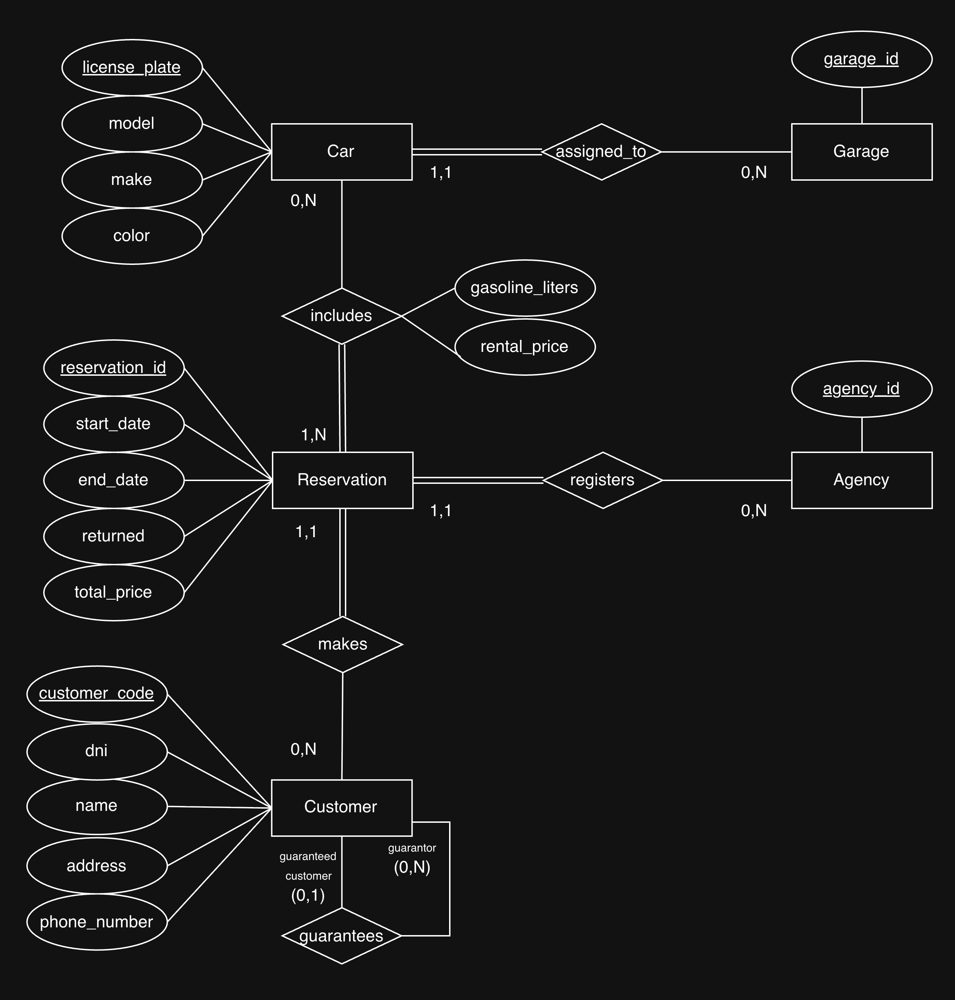
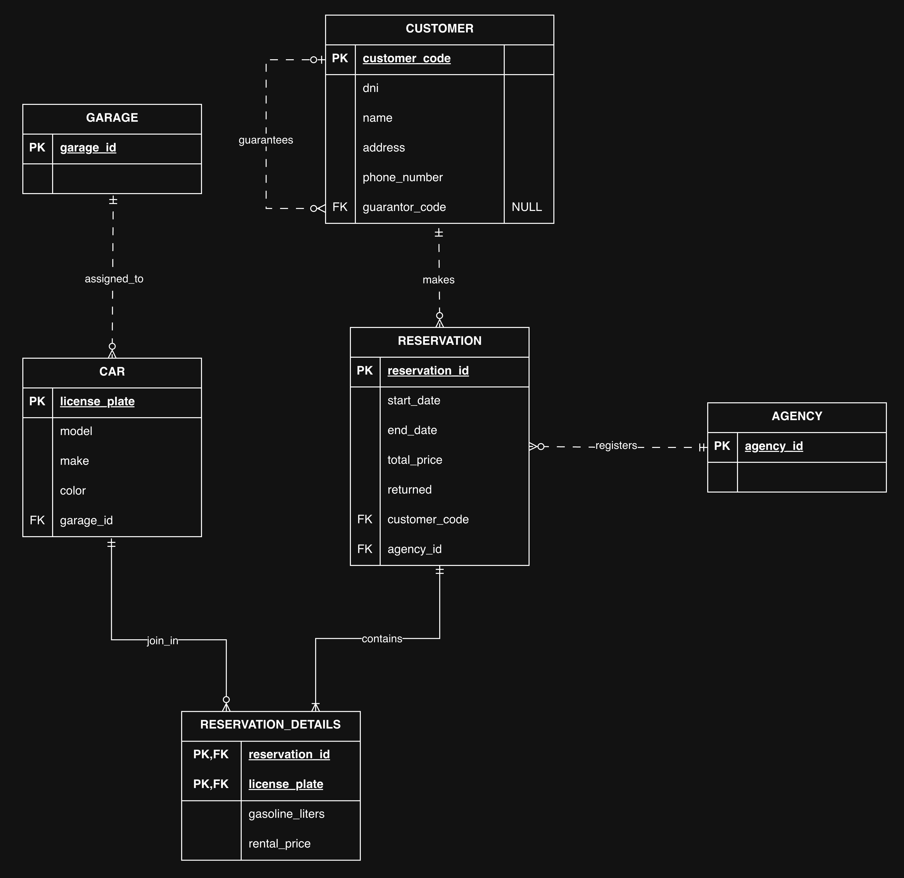

# Reserva de coches

Diseño de una base de datos para las reservas de una empresa de alquiler de automóviles. Se documentan el modelo de datos, las decisiones tomadas, su implementación en PostgreSQL y lo aprendido.

## Enunciado

> Se desea diseñar una base de datos sobre la información de las reservas de una empresa dedicada al alquiler de automóviles teniendo en cuenta que:
>
> Un determinado cliente puede tener en un momento dado hechas varias reservas.
>
> De cada cliente se desea almacenar su DNI, nombre, dirección y teléfono. Además, dos clientes se diferencian por un código único.
>
> Cada cliente puede ser avalado por otro cliente de la empresa.
>
> Una reserva la realiza un único cliente pero puede involucrar a varios coches.
>
> Es importante registrar la fecha de inicio y final de la reserva, el precio del alquiler de cada uno de los coches, los litros de gasolina en el depósito en el momento de realizar la reserva, el precio total de la reserva y un indicador de si el coche o los coches han sido entregados.
>
> No se mantienen los datos de reservas anteriores.
>
> Todo coche tiene siempre asignado un determinado garaje que no puede cambiar. De cada coche se requiere la matrícula, el modelo, el color y la marca.
>
> Cada reserva se realiza en una determinada agencia.

## Diseño

El modelo conceptual tiene **cinco entidades**. El modelo relacional tiene **seis tablas**, al añadir `reservation_details` para la relación entre reservas y coches.

| Entidad | Tabla SQL     | Clave primaria (PK) |
| ------- | ------------- | ------------------- |
| Cliente | `customer`    | `customer_code`     |
| Reserva | `reservation` | `reservation_id`    |
| Coche   | `car`         | `license_plate`     |
| Agencia | `agency`      | `agency_id`         |
| Garaje  | `garage`      | `garage_id`         |

Las cardinalidades `(mínimo, máximo)` indican cuántos vínculos puede tener cada instancia de la entidad señalada; `N` permite varios.

| Relación                     | Participación de cada entidad     | Interpretación                                                                                |
| ---------------------------- | --------------------------------- | --------------------------------------------------------------------------------------------- |
| Cliente realiza reserva      | Cliente `(0,N)`; reserva `(1,1)`  | Un cliente puede no tener reservas o tener varias; cada reserva pertenece a un único cliente. |
| Agencia registra reserva     | Agencia `(0,N)`; reserva `(1,1)`  | Una agencia puede registrar varias reservas; cada reserva se realiza en una única agencia.    |
| Coche está asignado a garaje | Coche `(1,1)`; garaje `(0,N)`     | Cada coche tiene un garaje; un garaje puede estar vacío o tener varios coches.                |
| Reserva incluye coche        | Reserva `(1,N)`; coche `(0,N)`    | Una reserva incluye al menos un coche; un coche puede participar en distintas reservas.       |
| Cliente avala a cliente      | Avalador `(0,N)`; avalado `(0,1)` | Un cliente puede avalar a varios; cada cliente puede tener como máximo un avalador.           |

### Decisiones e interpretación

- Se añaden identificadores para reserva, agencia y garaje porque el enunciado no los define. Los identificadores numéricos se generan con `IDENTITY`; la matrícula es una clave natural.
- `agency` y `garage` solo contienen su identificador: no se solicitan más atributos.
- El término «entregados» se interpreta como **devueltos a la empresa**: `returned = TRUE` indica la devolución de todos los coches de la reserva. Su valor inicial es `FALSE` y no se registran devoluciones parciales.
- `rental_price` representa el importe completo del alquiler de un coche en una reserva, en una misma moneda. El total esperado es `total_price = SUM(rental_price)` de sus detalles.
- Las fechas no incluyen hora (`DATE`) y pueden coincidir. Los datos son obligatorios salvo `customer.guarantor_code`, porque el aval es opcional.

### Modelo conceptual (Chen)

  

### Modelo lógico (relacional)

  

Fuente editable de ambos diagramas: [car-reservation.drawio](diagrams/car-reservation.drawio).

## Implementación en PostgreSQL

El [esquema SQL](schema.sql) crea las seis tablas y sus restricciones dentro de una transacción.

| Regla aplicada en el esquema                    | Mecanismo                                       |
| ----------------------------------------------- | ----------------------------------------------- |
| Las referencias apuntan a registros existentes. | Claves foráneas (FK).                           |
| Un coche no se repite en la misma reserva.      | PK compuesta `(reservation_id, license_plate)`. |
| Un cliente no puede avalarse a sí mismo.        | `ck_customer_guarantor_different`.              |
| La fecha final no precede a la inicial.         | `ck_reservation_dates`.                         |
| Los importes y los litros no son negativos.     | Restricciones `CHECK`.                          |
| El garaje asignado a un coche no puede cambiar. | Disparador `car_garage_fixed`.                  |

**Reglas aún no implementadas:**

- Exigir al menos un coche por reserva. Debe validarse al crearla y al eliminar o trasladar detalles, antes de confirmar la transacción.
- Mantener el total igual a la suma de los detalles cuando cambien los coches o sus precios.
- Eliminar reservas anteriores. Falta definir cuándo se consideran anteriores y ejecutar el borrado; `returned` no lo hace automáticamente. Al borrar una reserva, `ON DELETE CASCADE` elimina sus detalles.
- Evitar reservas con fechas solapadas para un mismo coche; el esquema no valida la disponibilidad temporal.

Estas reglas requieren lógica adicional en la aplicación, tareas de cierre o restricciones y disparadores, según corresponda.

## Lo aprendido

- Las relaciones 1:N se representan con una FK en el lado N: `reservation.customer_code`, `reservation.agency_id` y `car.garage_id`.
- La relación N:M necesita `reservation_details`. El precio y la gasolina pertenecen a la combinación reserva–coche; su PK compuesta evita repetir la pareja, aunque cada clave pueda repetirse por separado.
- El aval es una relación recursiva entre clientes, con roles de avalador y avalado. Se representa con la FK opcional `customer.guarantor_code` hacia `customer.customer_code`.
- Una regla dibujada en el modelo no queda garantizada solo por crear una FK. La reserva debe tener al menos un coche, pero esa condición necesita una validación adicional.
