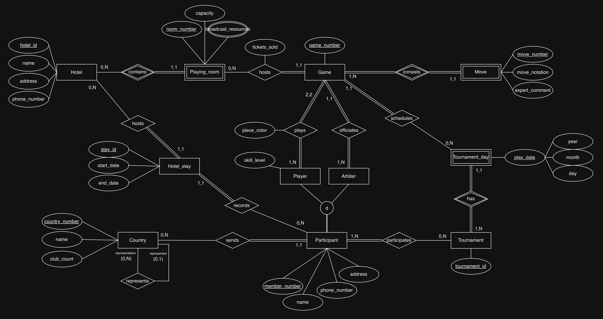
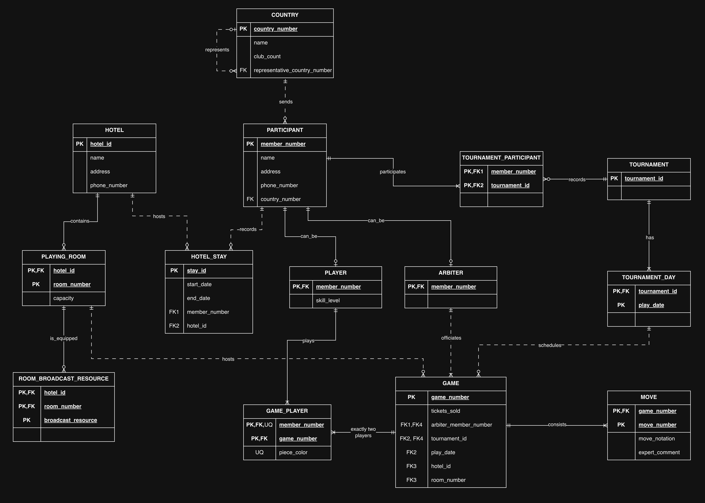

# Torneo de ajedrez

Diseño de una base de datos para gestionar campeonatos de ajedrez, sus participantes, partidas y alojamientos. Se documentan el modelo de datos, las decisiones tomadas, su implementación en PostgreSQL y lo aprendido.

## Enunciado

> Se desea realizar una base de datos relacionada a la gestión de un torneo de ajedrez:
>
> En el campeonato participan jugadores y árbitros, de ambos se requiere conocer el numero de asociado, nombre, dirección, teléfono de contacto y campeonatos en los que ha participado (como jugador o arbitro).
>
> De los jugadores se precisa ademas el nivel de juego en una escala de 1 a 10.
>
> Ningún arbitro puede participar como jugador.
>
> Los países envían al campeonato un conjunto de jugadores y árbitros, aunque no todos los países envían participantes. Todo jugador y arbitro es enviado por un único pais.
>
> Un país puede ser representado por otro pais
>
> Cada país se identifica por un numero correlativo según su orden alfabético e interesa conocer ademas su nombre, el numero de clubes de ajedrez existentes en el mismo.
>
> Cada partido se identifica por un numero correlativo, la juegan dos jugadores y la arbitra un arbitro. Interesa registrar las partidas que juega cada jugador y el color (blancas o negras) con el que juega.
>
> Todo participante participa en al menos una partida.
>
> Tanto jugadores como árbitros se alojan en hoteles en los que se desarrollan las partidas, se desea conocer en que hotel y en que fechas se ha alojado cada uno de los participantes.
>
> Los participantes no tienen porque alojarse en un hotel.
>
> De cada hotel se desea conocer el nombre, dirección y telefono.
>
> El campeonato se desarrolla a lo largo de una serie de jornadas (año, mes, día).
>
> Cada partida se celebra en una de las salas de los hoteles, se desea conocer el numero de entradas vendidas en la sala para cada partida.
>
> De cada sala se desea conocer la capacidad y medios que dispone para facilitar la transmisión de los encuentros.
>
> De cada partida, se registran todos los movimientos que la componen, la identificación de movimiento se establece en base a un numero de orden dentro de cada partida.
>
> Para cada movimiento se guardan la jugada y un breve comentario de un experto.

## Diseño

El modelo conceptual tiene **nueve entidades** y **dos subtipos de participante**. El modelo relacional tiene **14 tablas**, al añadir `tournament_participant` y `game_player` para las relaciones N:M, y `room_broadcast_resource` para los medios de transmisión de cada sala.

| Entidad      | Tabla SQL        | Clave primaria (PK)          |
| ------------ | ---------------- | ---------------------------- |
| País         | `country`        | `country_number`             |
| Participante | `participant`    | `member_number`              |
| Jugador      | `player`         | `member_number`              |
| Árbitro      | `arbiter`        | `member_number`              |
| Campeonato   | `tournament`     | `tournament_id`              |
| Jornada      | `tournament_day` | `(tournament_id, play_date)` |
| Hotel        | `hotel`          | `hotel_id`                   |
| Estancia     | `hotel_stay`     | `stay_id`                    |
| Sala         | `playing_room`   | `(hotel_id, room_number)`    |
| Partida      | `game`           | `game_number`                |
| Movimiento   | `move`           | `(game_number, move_number)` |

Las cardinalidades `(mínimo, máximo)` indican cuántos vínculos puede tener cada instancia de la entidad señalada; `N` permite varios.

| Relación                             | Participación de cada entidad               | Interpretación                                                                                         |
| ------------------------------------ | ------------------------------------------- | ------------------------------------------------------------------------------------------------------ |
| País envía participante              | País `(0,N)`; participante `(1,1)`          | Un país puede no enviar participantes o enviar varios; cada participante es enviado por un único país. |
| País representa a país               | Representante `(0,N)`; representado `(0,1)` | Un país puede representar a varios; cada país puede tener como máximo un representante.                |
| Participante participa en campeonato | Participante `(1,N)`; campeonato `(0,N)`    | Un participante tiene historial en uno o varios campeonatos; un campeonato puede no tener inscritos.   |
| Campeonato tiene jornada             | Campeonato `(1,N)`; jornada `(1,1)`         | Cada campeonato tiene al menos una jornada; cada jornada pertenece a un único campeonato.              |
| Hotel contiene sala                  | Hotel `(0,N)`; sala `(1,1)`                 | Un hotel puede tener varias salas; cada sala pertenece a un único hotel.                               |
| Participante registra estancia       | Participante `(0,N)`; estancia `(1,1)`      | El alojamiento es opcional; cada estancia corresponde a un único participante.                         |
| Hotel acoge estancia                 | Hotel `(0,N)`; estancia `(1,1)`             | Un hotel puede registrar varias estancias; cada estancia ocurre en un único hotel.                     |
| Jugador juega partida                | Jugador `(1,N)`; partida `(2,2)`            | Cada jugador juega al menos una partida; cada partida tiene exactamente dos jugadores.                 |
| Árbitro arbitra partida              | Árbitro `(1,N)`; partida `(1,1)`            | Cada árbitro arbitra al menos una partida; cada partida tiene un único árbitro.                        |
| Jornada programa partida             | Jornada `(0,N)`; partida `(1,1)`            | Una jornada puede no tener partidas o tener varias; cada partida se programa en una única jornada.     |
| Sala alberga partida                 | Sala `(0,N)`; partida `(1,1)`               | Una sala puede albergar varias partidas; cada partida se celebra en una única sala.                    |
| Partida se compone de movimiento     | Partida `(1,N)`; movimiento `(1,1)`         | Cada partida tiene al menos un movimiento; cada movimiento pertenece a una única partida.              |

### Decisiones e interpretación

- La especialización de participante es **total y disjunta**: cada participante debe ser jugador o árbitro, exactamente uno. Los subtipos usan `member_number` como PK y como clave foránea (FK) hacia `participant`; los datos personales se guardan una sola vez.
- El historial se guarda en `tournament_participant`. El rol se deduce del subtipo de la persona y se mantiene entre campeonatos; no se almacena en cada inscripción.
- Se añaden identificadores para campeonato, hotel y estancia, y un número de sala dentro de cada hotel. `tournament` solo contiene su identificador. Los identificadores se proporcionan al insertar datos; el SQL no los genera automáticamente.
- Se supone que `game_number` es único en toda la base y no reinicia su numeración en cada campeonato. La numeración de países debe seguir el orden alfabético del enunciado.
- Jornada, sala y movimiento son **entidades débiles**: se identifican junto con su campeonato, hotel y partida, respectivamente. La fecha o el número local solo los distingue dentro de su entidad propietaria.
- La representación entre países es opcional y se interpreta con un único representante como máximo. `country.representative_country_number` apunta al país representante; `NULL` indica que no tiene uno.
- El color pertenece a la combinación jugador–partida y se guarda en `game_player` como `white` o `black`. Las entradas vendidas corresponden a cada partida celebrada en una sala y se guardan en `game.tickets_sold`.
- `hotel_stay` permite registrar visitas repetidas al mismo hotel, con fechas de inicio y fin que pueden coincidir. El alojamiento opcional se expresa permitiendo que un participante no tenga estancias.
- Los medios de transmisión son un atributo multivaluado: `room_broadcast_resource` guarda una fila por recurso de cada sala.
- Se permiten campeonatos sin inscritos y jornadas sin partidas para registrar su planificación. El mínimo de un movimiento por partida supone encuentros con jugadas registradas; para partidas todavía no iniciadas, ese mínimo debería ser cero.
- Las fechas usan `DATE`, que reúne año, mes y día. Los teléfonos se guardan como texto. Las longitudes de los textos son decisiones de implementación; los datos son obligatorios salvo `country.representative_country_number`.

### Modelo conceptual (Chen)

  

### Modelo lógico (relacional)

  

Fuente editable de ambos diagramas: [chess-tournament.drawio](diagrams/chess-tournament.drawio).

## Implementación en PostgreSQL

El [esquema SQL](schema.sql) crea las 14 tablas y sus restricciones dentro de una transacción.

| Regla aplicada en el esquema                                                        | Mecanismo                                                                                           |
| ----------------------------------------------------------------------------------- | --------------------------------------------------------------------------------------------------- |
| Las referencias apuntan a registros existentes.                                     | Claves foráneas (FK).                                                                               |
| Las jornadas, salas y movimientos se identifican dentro de su entidad propietaria.  | PK compuestas de `tournament_day`, `playing_room` y `move`.                                         |
| No se repiten una inscripción, un jugador en una partida ni un recurso en una sala. | PK de `tournament_participant`, `game_player` y `room_broadcast_resource`.                          |
| Cada partida tiene un árbitro, una jornada y una sala.                              | FK obligatorias; las referencias a jornada y sala son compuestas.                                   |
| El árbitro está inscrito en el campeonato de la partida.                            | FK compuesta `fk_game_registered_arbiter`.                                                          |
| Una partida admite como máximo dos jugadores distintos, con colores diferentes.     | PK de `game_player`, color obligatorio (`NOT NULL`), `CHECK` y `UNIQUE (game_number, piece_color)`. |
| Un país no puede representarse a sí mismo.                                          | `ck_country_representative`.                                                                        |
| La fecha final de una estancia no precede a la inicial.                             | `ck_hotel_stay_dates`.                                                                              |
| El nivel es un entero entre 1 y 10; clubes, capacidad y entradas no son negativos.  | Tipos enteros y restricciones `CHECK`.                                                              |
| Los números de país, sala y movimiento son positivos.                               | Restricciones `CHECK`.                                                                              |

Todas las FK usan `ON DELETE RESTRICT`: se rechaza borrar un registro mientras existan filas que lo referencien.

**Reglas aún no implementadas:**

- Exigir que cada participante sea jugador o árbitro, exactamente uno: no puede quedar sin subtipo ni aparecer en ambos.
- Exigir exactamente dos jugadores por partida, uno con blancas y otro con negras. Las restricciones actuales fijan el máximo, pero admiten cero o un jugador.
- Exigir al menos un campeonato por participante y al menos una partida jugada o arbitrada, según su subtipo.
- Comprobar que los jugadores estén inscritos en el campeonato de su partida. La inscripción del árbitro ya está garantizada por su FK compuesta.
- Exigir al menos una jornada por campeonato y un movimiento por partida, según los mínimos del modelo.
- Asignar la numeración correlativa de países según el orden alfabético y la de partidas. Las PK garantizan unicidad, pero no esa numeración.

Estas reglas requieren lógica adicional en la aplicación o en la base de datos, considerando altas, cambios, borrados y operaciones concurrentes. Los mínimos deben comprobarse cuando se hayan registrado las filas relacionadas, antes de confirmar la transacción.

## Lo aprendido

- Las relaciones N:M se representan con tablas intermedias: `tournament_participant` guarda el historial y `game_player` guarda el color, que depende de la pareja jugador–partida.
- Una entidad débil necesita la clave de su propietaria. Una FK compuesta comprueba la combinación completa: que exista una sala 2 no basta; debe existir en el hotel indicado.
- Un atributo multivaluado se convierte en otra tabla. Cada medio de transmisión ocupa una fila de `room_broadcast_resource`, en lugar de una lista dentro de la sala.
- El alojamiento opcional permite cero filas en `hotel_stay`; cada estancia que sí se registre necesita participante y hotel obligatorios.
- Una PK que también es FK vincula un subtipo con su participante, pero no garantiza que todos los participantes tengan exactamente un subtipo.
- `CHECK` y `UNIQUE` limitan los colores y el máximo de jugadores por partida; exigir que estén ambos necesita validar el conjunto de filas.
- Una FK compuesta puede expresar una regla entre tablas sin disparadores: `game` reutiliza el árbitro y el campeonato para comprobar su inscripción en `tournament_participant`.
