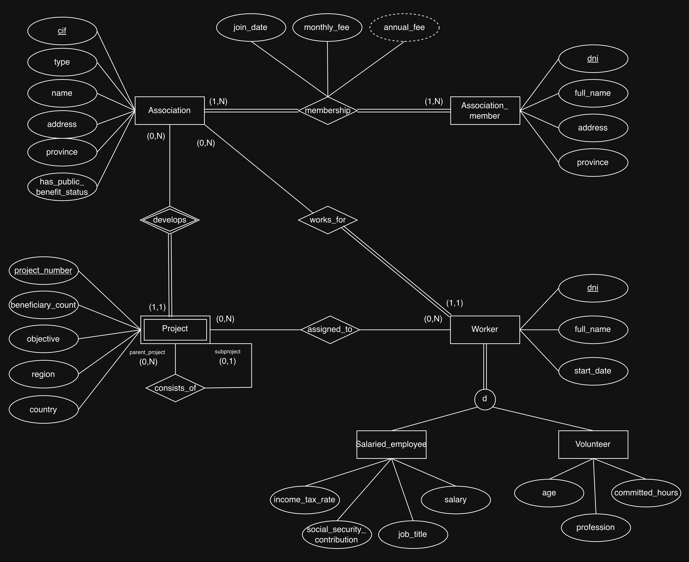
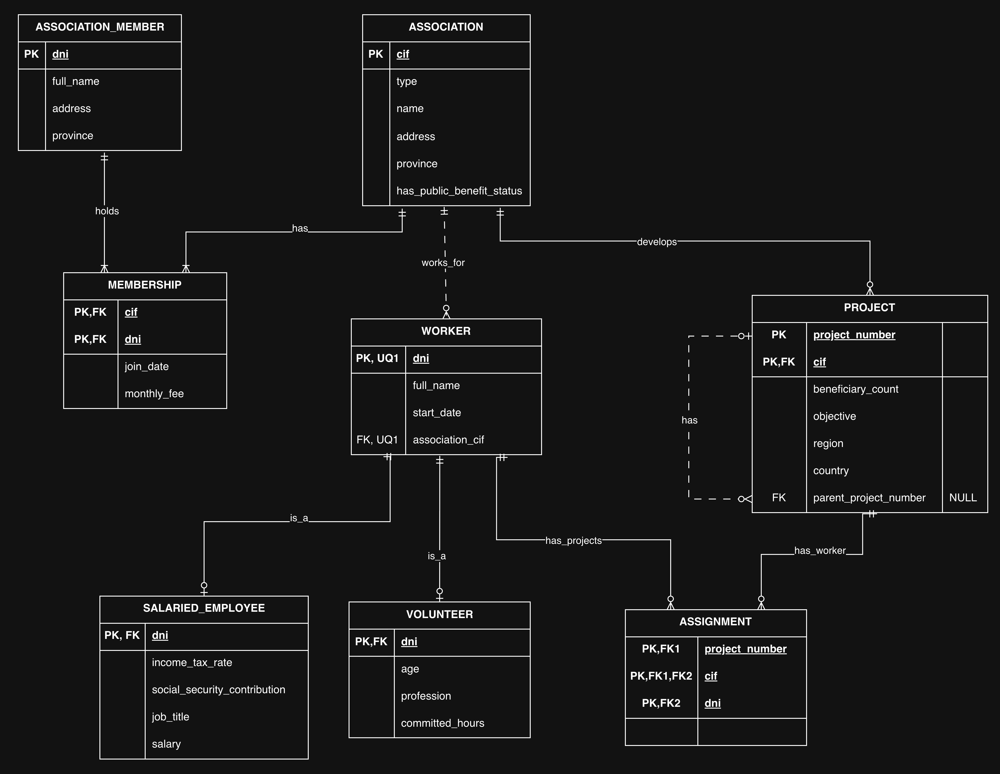

# Coordinadora nacional de ONGs

Diseño de una base de datos para las asociaciones de una coordinadora nacional de ONGs, sus socios, trabajadores y proyectos. Se documentan el modelo de datos, las decisiones tomadas, su implementación en PostgreSQL y lo aprendido.

## Enunciado

> La coordinadora nacional de ONGs desea mantener una base de datos de las asociaciones de este tipo que existen en nuestro país.
>
> Para ello necesita almacenar información sobre cada asociación, los socios que las componen, los proyectos que realizan y los trabajadores de las mismas.
>
> De las asociaciones se desea almacenar su CIF, denominación, dirección y provincia, su tipo (ecologista, integración, desarrollo, …), así como si está declarada de utilidad pública por el Ministerio del Interior.
>
> Cada asociación está formada por socios de los que se precisa conocer su DNI, nombre, dirección, provincia, fecha de alta en la asociación, la cuota mensual con que colaboran y la aportación anual que realizan (que se obtendrá multiplicando la cuota mensual por los meses del año).
>
> Los trabajadores de estas organizaciones pueden ser de dos tipos: asalariados y voluntarios.
>
> Los asalariados son trabajadores que cobran un sueldo y ocupan cierto cargo en la asociación. Se desea almacenar la cantidad que éstos pagan a la Seguridad Social y el tanto por ciento de IRPF que se les descuenta.
>
> Los voluntarios trabajan en la organización desinteresadamente, siendo preciso conocer su edad, profesión y las horas que dedican a la asociación a efectos de cálculo de estadísticas.
>
> Cada trabajador se identifica por su DNI, tiene un nombre y fecha de ingreso.
>
> Un socio no puede ser trabajador de la asociación.
>
> Las asociaciones llevan a cabo proyectos a los que están asignados sus trabajadores.
>
> De cada proyecto se desea almacenar su número de identificación dentro de la asociación, en qué país se lleva a cabo y en qué zona de este, así como el objetivo que persigue y el número de beneficiarios a los que afecta.
>
> Un proyecto se compone a su vez de subproyectos.

## Diseño

El modelo conceptual tiene **cuatro entidades principales** y **dos subtipos de trabajador**. El modelo relacional tiene **ocho tablas**, al añadir `membership` para la pertenencia de socios a asociaciones y `assignment` para la asignación de trabajadores a proyectos.

| Entidad    | Tabla SQL            | Clave primaria (PK)     |
| ---------- | -------------------- | ----------------------- |
| Asociación | `association`        | `cif`                   |
| Socio      | `association_member` | `dni`                   |
| Trabajador | `worker`             | `dni`                   |
| Asalariado | `salaried_employee`  | `dni`                   |
| Voluntario | `volunteer`          | `dni`                   |
| Proyecto   | `project`            | `(cif, project_number)` |

Las cardinalidades `(mínimo, máximo)` indican cuántos vínculos puede tener cada instancia de la entidad señalada; `N` permite varios.

| Relación                            | Participación de cada entidad          | Interpretación                                                                                                         |
| ----------------------------------- | -------------------------------------- | ---------------------------------------------------------------------------------------------------------------------- |
| Socio pertenece a asociación        | Socio `(1,N)`; asociación `(1,N)`      | Un socio pertenece a una o varias asociaciones; cada asociación tiene al menos un socio.                               |
| Trabajador trabaja en asociación    | Trabajador `(1,1)`; asociación `(0,N)` | Cada trabajador pertenece a una única asociación; una asociación puede no tener trabajadores o tener varios.           |
| Asociación realiza proyecto         | Asociación `(0,N)`; proyecto `(1,1)`   | Una asociación puede realizar varios proyectos; cada proyecto pertenece a una única asociación.                        |
| Trabajador está asignado a proyecto | Trabajador `(0,N)`; proyecto `(0,N)`   | Un trabajador puede participar en varios proyectos y un proyecto tener varios trabajadores; la asignación es opcional. |
| Proyecto se compone de proyecto     | Padre `(0,N)`; hijo `(0,1)`            | Un proyecto puede tener varios subproyectos; cada proyecto tiene como máximo un padre.                                 |

### Decisiones e interpretación

- Se permite que un socio pertenezca a varias asociaciones. La fecha de alta y la cuota mensual describen cada pertenencia y se guardan en `membership`. La aportación anual se calcula como `monthly_fee × 12`, usando la cuota vigente, como indica el enunciado.
- Se supone que cada trabajador pertenece a una sola asociación y solo puede asignarse a proyectos de ella. Su fecha de ingreso se guarda en `worker.start_date`.
- La especialización de trabajador es **total y disjunta**: cada trabajador debe ser asalariado o voluntario, exactamente uno. Cada subtipo conserva el DNI como PK y como clave foránea (FK) hacia `worker`.
- La prohibición de ser socio y trabajador se aplica a la **misma asociación**, comparando DNI y CIF. Una persona puede ser socia de una asociación y trabajadora de otra.
- `project` representa una **entidad débil**: su número solo identifica al proyecto dentro de su asociación. Dos asociaciones pueden tener un proyecto número 1; su clave completa es `(cif, project_number)`.
- Cada subproyecto es otro registro de `project`, con un único padre como máximo, de la misma asociación. `parent_project_number = NULL` identifica un proyecto principal; la jerarquía debe estar libre de ciclos.
- El enunciado no fija la periodicidad de las horas dedicadas por los voluntarios (`committed_hours`).
- CIF y DNI se conservan como claves naturales. Las fechas usan `DATE` y los importes `NUMERIC`; las longitudes y precisiones son decisiones de implementación. Los datos son obligatorios salvo `project.parent_project_number`, porque el padre es opcional.

### Modelo conceptual (Chen)

  

### Modelo lógico (relacional)

  

Fuente editable de ambos diagramas: [national-ngo-coordination.drawio](diagrams/national-ngo-coordination.drawio).

## Implementación en PostgreSQL

El [esquema SQL](schema.sql) crea las ocho tablas, sus restricciones, los índices de apoyo, la función y los disparadores de exclusión entre socio y trabajador, y la vista `annual_fees` dentro de una transacción.

| Regla aplicada en el esquema                                                                                                           | Mecanismo                                                                                        |
| -------------------------------------------------------------------------------------------------------------------------------------- | ------------------------------------------------------------------------------------------------ |
| Las referencias apuntan a registros existentes.                                                                                        | Claves foráneas (FK).                                                                            |
| Los datos son obligatorios salvo el proyecto padre, que es opcional.                                                                   | `NOT NULL`, PK y `parent_project_number` admite `NULL`.                                          |
| Un socio no se repite en la misma asociación y un trabajador no se asigna dos veces al mismo proyecto.                                 | PK compuestas de `membership` y `assignment`.                                                    |
| El número de un proyecto es único dentro de su asociación.                                                                             | PK compuesta `(cif, project_number)`.                                                            |
| Trabajador y proyecto de una asignación pertenecen a la misma asociación.                                                              | Dos FK compuestas que comparten `cif`.                                                           |
| Una persona no puede ser socia y trabajadora de la misma asociación.                                                                   | Dos disparadores y una función que comprueba DNI y CIF, coordinando las escrituras concurrentes. |
| Un subproyecto tiene un padre de su misma asociación y no puede ser su propio padre.                                                   | FK compuesta de `project` y `ck_project_no_self_parent`.                                         |
| Los importes, las horas, la edad y los beneficiarios no son negativos; el número de proyecto es positivo y el IRPF está entre 0 y 100. | Restricciones `CHECK`.                                                                           |
| La aportación anual se obtiene multiplicando la cuota mensual vigente por 12.                                                          | Vista `annual_fees`.                                                                             |

**Reglas aún no implementadas:**

- Exigir al menos un socio por asociación y al menos una asociación por socio.
- Exigir que cada trabajador sea asalariado o voluntario, exactamente uno: no puede quedar sin subtipo ni aparecer en ambos.
- Evitar ciclos entre varios proyectos, como A → B → A. La FK comprueba que el padre existe y pertenece a la misma asociación; el `CHECK` solo evita que un proyecto sea su propio padre.

Estas reglas forman parte del modelo. Para garantizarlas se necesita lógica adicional en la aplicación o en la base de datos, considerando altas, cambios, borrados y operaciones concurrentes.

## Lo aprendido

- Una relación N:M se representa mediante una tabla intermedia: `membership` también guarda la fecha de alta y la cuota, que pertenecen a la relación socio–asociación.
- Una entidad débil se identifica junto con su propietaria: la clave de `project` combina el CIF de la asociación y su número de proyecto.
- Las FK compuestas pueden expresar una regla entre tablas sin añadir disparadores: `assignment` comparte el mismo CIF en sus referencias a trabajador y proyecto.
- Una PK que también es FK relaciona cada subtipo con su trabajador, pero no garantiza que todos los trabajadores tengan exactamente un subtipo.
- Una FK asegura que el registro referenciado existe; no exige que cada asociación tenga socios ni evita ciclos entre varios proyectos.
- Una regla que compara tablas puede necesitar disparadores y coordinación entre transacciones. La exclusión entre socio y trabajador comprueba DNI y CIF en ambas direcciones, incluyendo actualizaciones y operaciones simultáneas.
